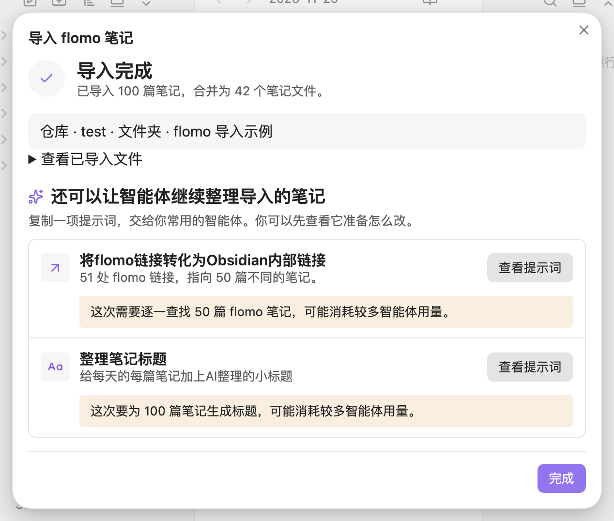

# Flomo ZIP Import

<div align="center">

简体中文 · [English](README_EN.md)

**将 Flomo 导出的笔记转换为 Obsidian Markdown，支持 Windows、macOS 和 Linux 桌面端**

🔒 **100% 本地离线解析 · 数据不离开你的设备**

[功能特性](#功能特性) · [安装插件](#安装插件) · [开始导入](#开始导入) · [笔记格式](#笔记格式) · [macOS 独立版](#macos-独立版)

</div>


## 功能特性

- **全桌面端支持**：基于 Obsidian 桌面插件实现（需 Obsidian 1.5.7 及以上版本），原生支持 Windows、macOS 与 Linux，同时兼容 Flomo 免费账号导出的 ZIP 压缩包。
- **100% 本地离线处理**：在本地直接解压与解析 Flomo HTML 导出文件，不加载外部资源、不发起任何网络请求，也不收集任何笔记或使用数据。
- **灵活的日期筛选与导入模式**：支持按起止日期筛选笔记，提供「按天合并」与「按篇独立」两种组织方式，并可在插件设置中配置默认导入方式与目标文件夹。
- **完整保留元数据与附件**：自动生成 `created` 和 `type` Frontmatter；导入图片与音频附件（如 PNG、JPG、WebP、M4A、MP3 等），附件存放位置遵循 Obsidian「文件与链接」设置，语音笔记以折叠 Callout 展示音频播放器及 Flomo 原生语音转文字内容。
- **导入前实时预览**：支持「阅读」与「Markdown 源码」双视图切换，可按需预览图片和播放音频，并在导入前查看重命名、缺失附件等提示。
- **安全写入与断点续传**：绝不覆盖仓库中已有的同名文件（自动追加 `-2`、`-3` 编号并同步更新嵌入链接）；若导入中途中断，再次导入同一批次时会自动续传，避免重复生成。
- **支持直接入库或导出 ZIP**：可直接写入当前 Obsidian 仓库指定文件夹，也可将转换结果（含 Markdown 与附件）另存为新的 ZIP 文件。
- **导入后可用智能体整理**：复制本次导入的提示词，让你常用的智能体把 flomo 链接转化为 Obsidian 内部链接，或根据正文整理笔记标题。

## 安装插件

适用于桌面版 Obsidian 1.5.7 及以上版本（Windows、macOS、Linux），支持 Flomo 免费账号导出的 ZIP 文件。

1. 打开要导入笔记的 Obsidian 仓库，进入「设置 → 第三方插件」。如果尚未开启社区插件，请先按提示启用。
2. 点击「浏览」，搜索 **Flomo ZIP Import**。
3. 打开插件详情页，点击「安装」，然后点击「启用」。

<details>
<summary>手动安装或从源码构建</summary>

- **手动安装**：从 Releases 下载 `main.js`、`manifest.json` 和 `styles.css`，放入 `<你的仓库>/.obsidian/plugins/flomo-zip-import/` 目录，然后在 Obsidian 中刷新并启用插件。
- **从源码构建**：在项目根目录执行：
  ```bash
  npm install && npm run build
  ```
  构建产物为根目录下的 `main.js`，配合 `manifest.json` 与 `styles.css` 即可加载。

</details>

## 开始导入

1. **在 Flomo 中导出笔记**：按照 [Flomo 官方导出说明](https://help.flomoapp.com/basic/storage.html) 导出你的笔记 ZIP 压缩包。
2. **打开导入窗口**：在 Obsidian 左侧功能区点击插件图标 ，拖拽或点击「选择 ZIP…」加载导出文件。
3. **设置、预览并导入**：选择日期范围、导入方式（「按天合并」或「按篇独立」）以及目标文件夹，点击「预览导入结果」确认内容后，点击「导入当前库」或「另存 ZIP…」。

> **提示**：如果左侧功能区被隐藏，可以按快捷键打开命令面板（Windows / Linux 为 `Ctrl + P`，macOS 为 `Command + P`），搜索并运行「**导入 flomo 笔记**」；也可以在「设置 → 第三方插件 → Flomo ZIP Import」中点击「开始导入…」。

<details>
<summary>查看导入预览截图</summary>


</details>

### 请智能体继续整理笔记（可选）

导入完成后，点击对应功能的「查看提示词」，复制给 Codex、WorkBuddy 等你常用的智能体，即可借助AI进一步整理笔记。



- **将 flomo 链接转化为 Obsidian 内部链接**。flomo 导出的 ZIP 不包含每篇笔记的ID，无法直接确定双向链接指向哪篇笔记。智能体可以在你已登录的 flomo 网页上查看目标笔记，根据正文和创建时间找到本次导入的对应笔记，再建立 Obsidian 内部链接。无法确认匹配时，保留原网址。
- **整理笔记标题**。让AI根据笔记正文总结生成笔记标题。

待处理的笔记较多时，完成页会提示可能消耗较多智能体用量。

## 笔记格式

### 按天合并

同一天的所有笔记合并为一个 Markdown 文件，以日期命名（`YYYY-MM-DD.md`）。

```markdown
---
created: 2026-03-03
type: daily
---

# 笔记首行内容

14:30:08 ^flomo-0001

笔记首行内容
笔记完整内容……

> [!tip]+ 语音
> 
> 语音转文字文本内容（若有）……


---

# 另一条笔记标题

16:12:30 ^flomo-0002

另一条笔记标题
另一条笔记完整内容……
```

- 每条笔记的第一行作为一级标题（自动去掉标题中的 `#` 标签符号）；超过 20 个字符时自动截断并加上 `…`，若首行为空则使用 `无标题 YYYY-MM-DD HHMMSS`。
- 一级标题下方保留笔记的原始时间和完整正文（包含首行）。时间行带有固定的块 ID，方便 Obsidian 内链跳到对应笔记。
- 同一天的多条笔记按时间顺序排列，彼此之间用 `---` 分隔。

### 按篇独立

每条 Flomo 笔记单独保存为一个 `.md` 文件，使用正文第一行作为文件名。

```markdown
---
created: 2026-03-03 14:30:00
type: card_note
---

笔记首行内容
笔记完整内容……

> [!tip]+ 语音
> 
> 语音转文字文本内容（若有）……


```

- 文件名截取前 20 个字符，自动清理系统非法字符并兼容 Windows 保留文件名，遇到重名文件时自动添加 `-2`、`-3` 编号。
- Frontmatter 中的 `created` 时间精确到秒（`YYYY-MM-DD HH:mm:ss`）。

### 通用规则

- **附件位置**：示例中的附件存放在 `Attachments` 子文件夹下，实际写入位置完全由当前仓库「设置 → 文件与链接」中的附件存放规则决定，并在正文中使用相对路径嵌入。
- **语音笔记**：以 Obsidian 展开的 Callout（`> [!tip]+ 语音`）格式呈现，内嵌音频播放链接并保留 Flomo 的语音转文字原文（无转文字时仅保留音频链接）。
- **正文细节**：保留原有的有序列表、无序列表、嵌套列表、`#标签` 以及 flomo 原笔记链接。


## 隐私与安全

- **零网络请求与零遥测**：ZIP 解压（`@zip.js/zip.js`）、HTML 解析（`parse5`）和 Markdown 转换全部在你的电脑本地内存中完成，完全断网也能正常使用。
- **智能体由用户选择**：复制提示词后，笔记如何处理取决于你使用的智能体。
- **安全解析**：在解析 Flomo HTML 时不创建浏览器 DOM，不执行脚本，也不会加载任何外部资源；禁止写入 `.obsidian` 配置目录，且永不覆盖仓库现有文件。
- **代码开源透明**：所有源码均在本仓库公开，欢迎随时审计和检查。

## macOS 独立版

如果你使用 macOS 13.0 (Ventura) 及以上版本，且更希望使用独立原生桌面应用而不安装 Obsidian 插件，可以继续下载之前的 macOS 独立版（v1.3.0）。

[下载 macOS 独立版 1.3.0](https://github.com/iBlinkQ/Flomo2Obsidian/releases/tag/1.3.0) · [查看独立版使用说明](https://github.com/iBlinkQ/Flomo2Obsidian/blob/1.3.0/README.md)


## 反馈与贡献

欢迎提交 Issue 和 Pull Request！

提交问题反馈时，建议附上操作系统版本、Obsidian 版本、插件版本以及复现步骤。如涉及笔记导出内容，请先做脱敏处理。[前往提交 Issue](https://github.com/iBlinkQ/Flomo2Obsidian/issues)

## 开源协议

本项目基于 [MIT 协议](LICENSE) 开源。感谢 Flomo 和 Obsidian，让碎片记录与长期知识整理顺畅衔接。

---

<div align="center">

**Crafted with ❤️ by iBlinkQ**

将闪念转化为持久的知识

</div>
