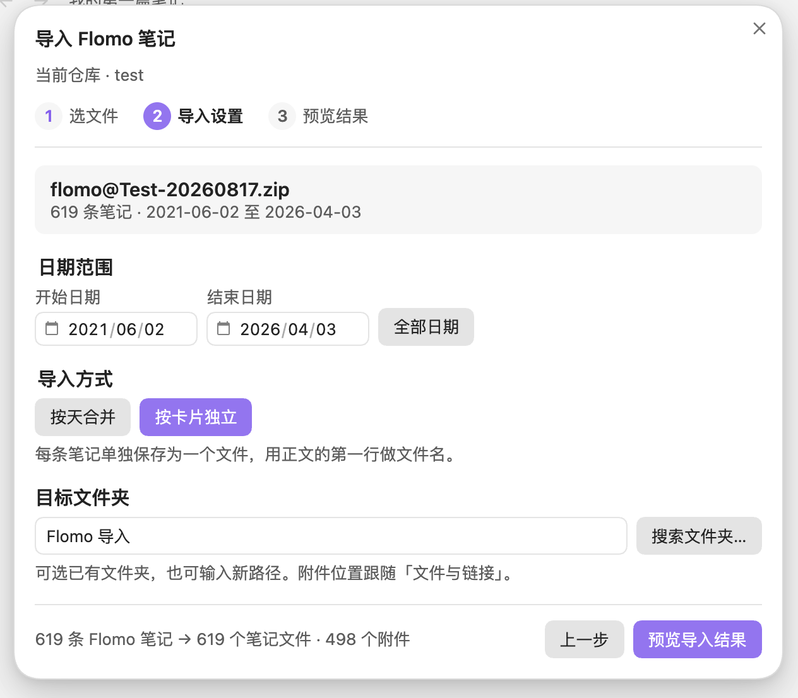
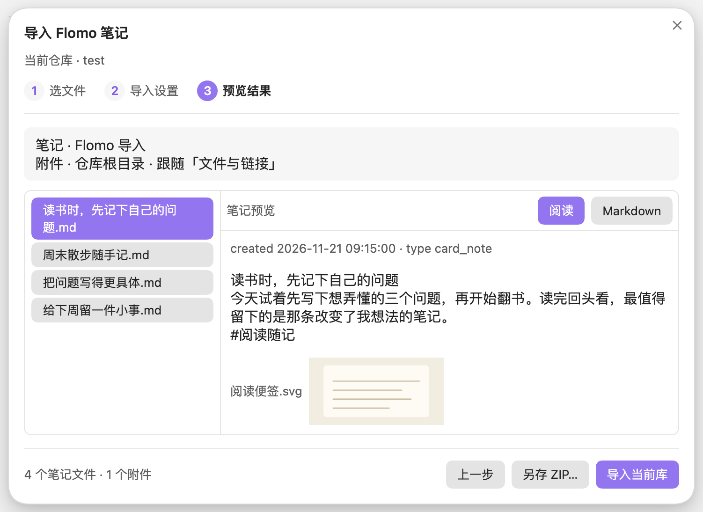

# Flomo ZIP Import

<div align="center">

**将你的 Flomo 笔记无缝转换为 Obsidian 格式**

一个轻量化的 Obsidian 桌面插件，帮助你将 Flomo 的闪念笔记迁移到 Obsidian 知识库

🔒 **100% 离线处理 · 数据安全无忧**

[安装插件](#安装插件) · [开始导入](#开始导入) · [下载 macOS 独立版](https://github.com/iBlinkQ/Flomo2Obsidian/releases/tag/1.3.0)

</div>



## 功能特性

- 🔒 **100% 离线处理** - 所有数据转换均在本地完成，不会上传到任何服务器，保障笔记隐私安全
- 📦 **一键导入** - 支持拖拽或选择 Flomo 导出的 ZIP 文件
- 📅 **灵活的日期筛选** - 自由选择需要转换的笔记时间范围
- 📝 **两种导入模式** - 支持「按天合并」和「按卡片独立」两种导入方式，适配不同笔记管理习惯
- 🏷️ **Frontmatter 支持** - 自动生成 `created` 和 `type` 元数据，便于 Obsidian 检索和管理
- 🖼️ **附件支持** - 自动处理并导入图片和语音（M4A）附件文件，语音以 Obsidian Callout 格式展示，并保留 Flomo 的语音转文字文本。附件位置遵循 Obsidian「文件与链接」中的设置
- 👀 **实时预览** - 导入前可预览 Markdown 格式的笔记内容，查看文件名和附件位置
- 📁 **直接写入仓库** - 可搜索并选择仓库里的目标文件夹，也可将转换结果另存为 ZIP


## 隐私安全

**你的笔记，只属于你自己**

- ✅ **零网络传输** - 所有数据处理均在你的电脑本地完成
- ✅ **无服务器交互** - 转换过程中不会连接任何远程服务器，不会上传任何数据
- ✅ **无数据收集** - 插件不收集笔记内容或使用数据
- ✅ **开源透明** - 代码完全开源，欢迎审查和验证
- ✅ **本地存储** - 转换后的文件保存在你指定的本地位置

## 安装插件

适用于桌面版 Obsidian 1.5.7 或更高版本。支持 Flomo 免费账号导出的 ZIP 文件。

1. 打开要导入笔记的 Obsidian 仓库，进入「设置 → 第三方插件」。如果页面提示启用社区插件，先按提示启用。
2. 点击「浏览」，搜索 **Flomo ZIP Import**。
3. 打开插件页面，点击「安装」，然后点击「启用」。

## 开始导入

1. **在 Flomo 中导出笔记。** [Flomo 官方导出说明](https://help.flomoapp.com/basic/storage.html)
2. **打开导入插件。** 在 Obsidian 左侧工具栏点击插件图标 ，选择刚导出的 ZIP 文件。
3. **预览并导入。** 选择日期范围、导入方式和目标文件夹，预览后点击「导入当前库」或「另存 ZIP…」。

> 如果左侧工具栏被隐藏，Windows 按 `Ctrl + P`，macOS 按 `Command + P` 打开命令面板，搜索并运行「导入 Flomo 笔记」。

<details>
<summary>查看导入预览截图</summary>



</details>

## 📝 笔记格式说明

### 按天导出

每个文件对应一天的笔记，文件名为 `YYYY-MM-DD.md`。

```markdown
---
created: 2026-03-03
type: daily
---

# 笔记首行内容

笔记首行内容
笔记完整内容……

> [!tip]+ 语音
> 
> 语音转文字文本内容（若有）……


---

# 另一条笔记标题

另一条笔记标题
另一条笔记完整内容……
```

- 每条笔记的第一行作为一级标题，超过 20 字会截断并显示 `…`。
- 标题下方展示笔记完整内容（包含首行）。
- 同一天的多条笔记按时间顺序排列，以 `---` 分隔。

### 按卡片导出

每条笔记单独保存为一个文件，用正文的第一行做文件名。

```markdown
---
created: 2026-03-03 14:30:00
type: card_note
---

笔记首行内容
笔记完整内容……

> [!tip]+ 语音
> 
> 语音转文字文本内容（若有）……


```

- 文件名自动清理非法字符，重名时自动编号。
- 创建时间精确到秒。

### 通用

- 示例中的附件存放在笔记旁边的 `Attachments` 子文件夹里。实际位置由 Obsidian「文件与链接」中的附件设置决定。
- 语音 Callout 包含嵌入的音频文件和 Flomo 的语音转文字原文（无转文字时仅保留音频链接）。
- 有序列表、无序列表和标签随正文保留。
- Flomo 卡片引用保留完整网址，点击可回到 Flomo 查看原卡片。

## macOS 独立版

另有 macOS 独立应用可下载。

[下载 macOS 独立版 1.3.0](https://github.com/iBlinkQ/Flomo2Obsidian/releases/tag/1.3.0) · [查看独立版使用说明](https://github.com/iBlinkQ/Flomo2Obsidian/blob/1.3.0/README.md)


## 🤝 贡献

欢迎提交 Issue 和 Pull Request！

反馈问题时，可附上系统版本、Obsidian 版本、插件版本和复现步骤。涉及笔记内容时，请用脱敏示例。 [提交 Issue](https://github.com/iBlinkQ/Flomo2Obsidian/issues)

## 📄 开源协议

本项目采用 [MIT 协议](LICENSE)开源。

## 💝 致谢

感谢 Flomo 和 Obsidian 两个优秀的笔记工具，让知识管理变得更加美好。

---

<div align="center">

**Crafted with ❤️ by iBlinkQ**

将闪念转化为持久的知识

</div>
