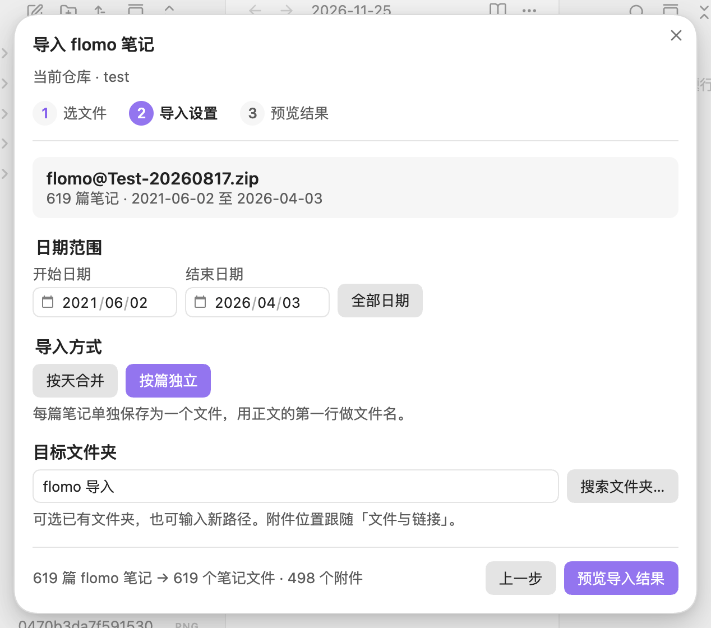
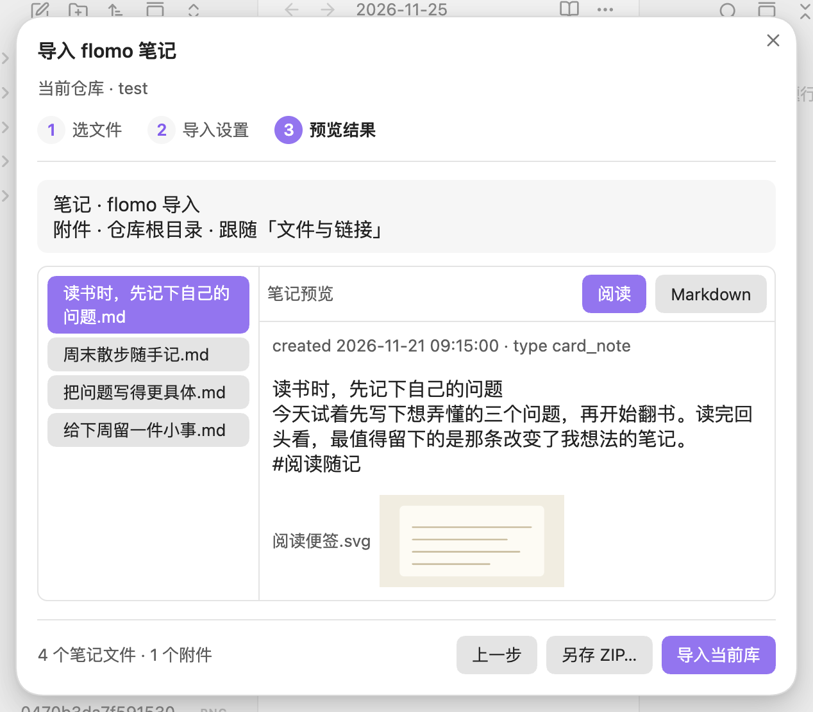

# Flomo ZIP Import

<div align="center">

[简体中文](README.md) · English

**Convert Flomo ZIP exports into Obsidian Markdown on Windows, macOS, and Linux**

🔒 **100% offline processing · Your notes stay on your device**

[Features](#features) · [Installation](#installation) · [How to import](#how-to-import) · [Output format](#output-format) · [macOS standalone app](#macos-standalone-app)

</div>



## Features

- **Cross-platform desktop plugin**: Built for desktop Obsidian (1.5.7 or later) on Windows, macOS, and Linux, supporting ZIP exports from free Flomo accounts as well as Pro accounts.
- **100% local and offline**: Reads the ZIP archive and parses Flomo HTML locally in memory, with zero network requests, zero telemetry, and no external resource loading.
- **Flexible date filtering and two import modes**: Filter notes by start and end dates, choose between merging notes by day or saving one file per card, and configure default mode and folder preferences in plugin settings.
- **Frontmatter and attachment support**: Generates `created` and `type` frontmatter automatically. Imports images and audio attachments (PNG, JPG, WebP, M4A, MP3, and more) according to your Obsidian "Files and links" attachment setting, rendering voice notes inside a callout with an embedded audio player and Flomo transcript.
- **Live dual-view preview**: Switch between Reading view and raw Markdown before writing anything, preview images and audio on demand, and review filename collision or missing attachment notices up front.
- **Non-destructive and resumable imports**: Never overwrites existing files in your vault (collisions are numbered `-2`, `-3` with links updated). Tracks import batches so an interrupted import can pick up cleanly without creating duplicates.
- **Import to vault or export as ZIP**: Write converted Markdown files and attachments directly into a chosen vault folder, or export the whole result as a new ZIP archive.

## Installation

Requires desktop Obsidian 1.5.7 or later (Windows, macOS, or Linux) and a ZIP export from Flomo.

1. Open your Obsidian vault and go to **Settings -> Community plugins**. Turn on community plugins if prompted.
2. Click **Browse** and search for **Flomo ZIP Import**.
3. Open the plugin page, click **Install**, and then click **Enable**.

<details>
<summary>Manual installation or building from source</summary>

- **Manual installation**: Download `main.js`, `manifest.json`, and `styles.css` from Releases, place them in `<your-vault>/.obsidian/plugins/flomo-zip-import/`, then reload and enable the plugin in Obsidian.
- **Build from source**: Run the following in the repository root:
  ```bash
  npm install && npm run build
  ```
  This outputs `main.js` in the root directory alongside `manifest.json` and `styles.css`.

</details>

## How to import

> **Note on interface language**: The plugin UI and commands are currently in Simplified Chinese. English equivalents for the main labels are included below so you can navigate without guessing.

1. **Export your notes from Flomo**: Follow the [official Flomo export guide](https://help.flomoapp.com/basic/storage.html) to download your ZIP archive.
2. **Open the importer**: Click the ribbon icon  in the left sidebar, then drag and drop your ZIP file or click **选择 ZIP…** (Choose ZIP).
3. **Configure, preview, and import**: Set your date range, import mode (**按天合并** / Merge by day, or **按卡片独立** / One file per card), and target folder (**目标文件夹**). Click **预览导入结果** (Preview import) to inspect the output, then choose **导入当前库** (Import to vault) or **另存 ZIP…** (Save as ZIP).

> **Tip**: If the ribbon is hidden, open the Command Palette (`Ctrl + P` on Windows/Linux, `Cmd + P` on macOS) and run **导入 Flomo 笔记** (Import Flomo Notes), or open the plugin settings tab and click **开始导入…** (Start import).

<details>
<summary>View import preview screenshot</summary>



</details>

## Output format

### Merge by day

Notes from the same date are combined into one `YYYY-MM-DD.md` file.

```markdown
---
created: 2026-03-03
type: daily
---

# First line of the note

First line of the note
Full body of the note...

> [!tip]+ 语音
> 
> Voice transcript text (if available)...


---

# Second note title

Second note title
Full body of the second note...
```

- Each note's first line becomes an H1 heading (tag `#` prefixes are stripped in the heading, truncated at 20 characters with `…`; empty first lines fall back to `无标题 YYYY-MM-DD HHMMSS`).
- The full note content (including the first line) appears below the heading.
- Multiple notes on the same day are sorted chronologically and separated by `---`.

### One file per card

Each note is saved as its own `.md` file, named after its first line.

```markdown
---
created: 2026-03-03 14:30:00
type: card_note
---

First line of the note
Full body of the note...

> [!tip]+ 语音
> 
> Voice transcript text (if available)...


```

- Filenames are capped at 20 characters, sanitized for invalid characters and Windows reserved device names, and automatically numbered (`-2`, `-3`) if a file with the same name already exists.
- The `created` frontmatter field preserves the exact timestamp to the second (`YYYY-MM-DD HH:mm:ss`).

### Shared details

- **Attachment location**: Attachments in the examples above live in an `Attachments` subfolder. Actual placement follows your vault's **Files and links** attachment setting, referenced with relative Markdown links.
- **Voice notes**: Rendered as an expanded Obsidian callout (`> [!tip]+ 语音`) containing the embedded audio link and the original Flomo transcript if present.
- **Formatting**: Ordered, unordered, and nested lists, `#tags`, and links back to original Flomo cards are preserved.


## Privacy and safety

- **No network calls or telemetry**: ZIP extraction (`@zip.js/zip.js`), HTML parsing (`parse5`), and Markdown generation run completely offline on your computer.
- **Safe parsing and writes**: Flomo HTML is parsed structurally without constructing a browser DOM, running scripts, or fetching remote assets. The importer blocks writes into `.obsidian` configuration directories and never overwrites existing vault files.
- **Open source**: The full source code is available in this repository for inspection.

## macOS standalone app

If you run macOS 13.0 (Ventura) or later and prefer a standalone native SwiftUI app instead of an Obsidian plugin, version 1.3.0 remains available.

[Download macOS standalone app 1.3.0](https://github.com/iBlinkQ/Flomo2Obsidian/releases/tag/1.3.0) · [Standalone app README](https://github.com/iBlinkQ/Flomo2Obsidian/blob/1.3.0/README.md)


## Contributing

Issues and pull requests are welcome.

When reporting a bug, please include your OS version, Obsidian version, plugin version, and steps to reproduce, along with a redacted sample if the issue involves specific note content. [Open an issue](https://github.com/iBlinkQ/Flomo2Obsidian/issues)

## License

Released under the [MIT License](LICENSE). Thanks to Flomo and Obsidian for making quick capture and long-term note-taking work well together.

---

<div align="center">

**Crafted with ❤️ by iBlinkQ**

Turn fleeting thoughts into lasting knowledge

</div>
